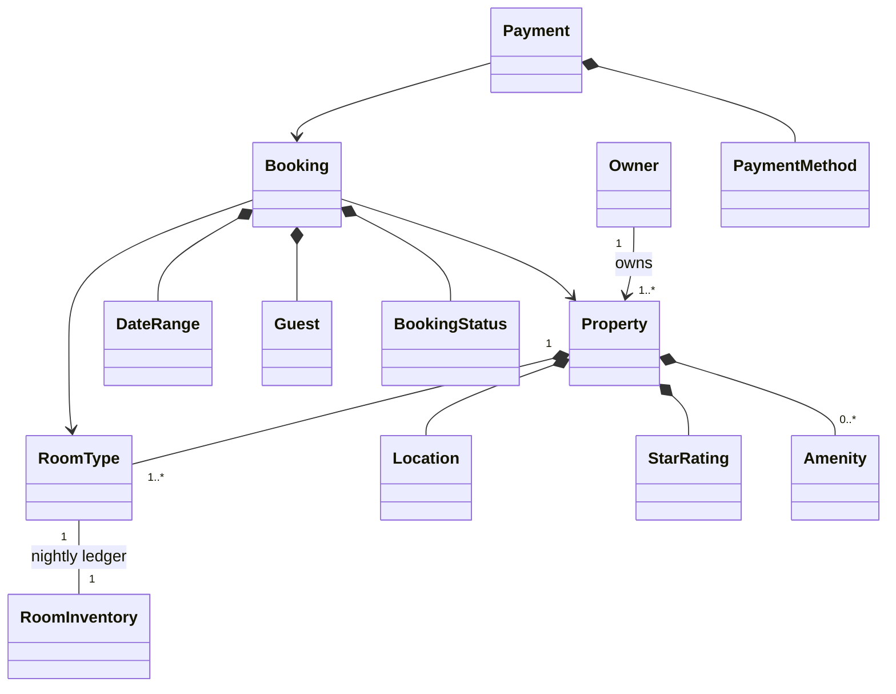
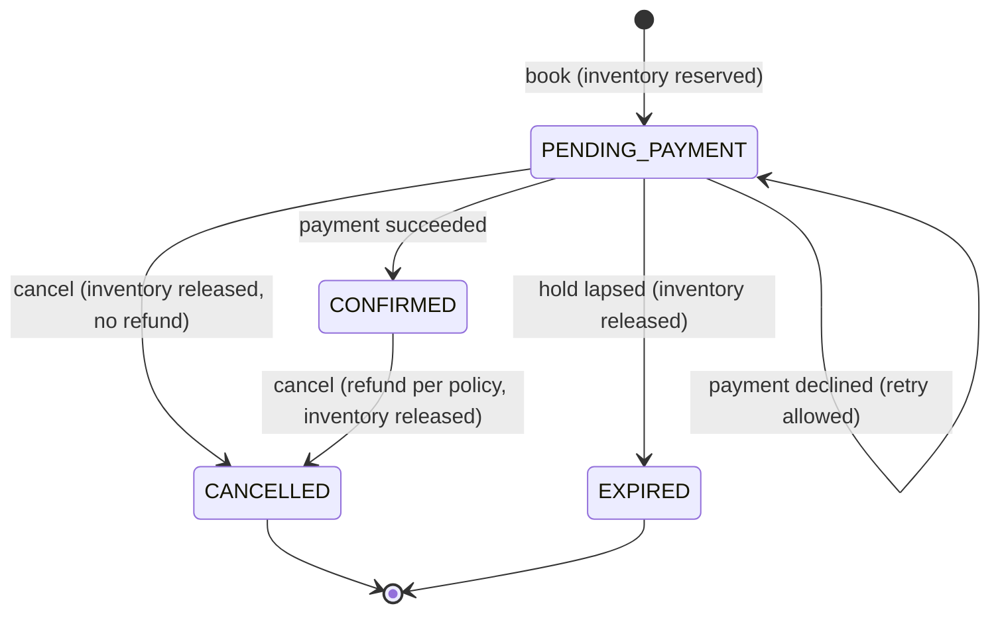

# Design Notes

The detailed reference behind the [README](../README.md): the full API, the domain model, the reasoning behind each key decision, how to extend the system, and what the tests cover.

## Contents

1. [API](#api)
2. [Design](#design)
3. [Key decisions and trade-offs](#key-decisions-and-trade-offs)
4. [Extending the system](#extending-the-system)
5. [Assumptions](#assumptions)
6. [Testing](#testing)
7. [With more time](#with-more-time)

---

## API

All paths start with `/api/v1`. Errors are returned as [RFC 7807](https://www.rfc-editor.org/rfc/rfc7807) `ProblemDetail` bodies.

| Operation | Endpoint | Notes |
|---|---|---|
| Register owner | `POST /owners` | Use this for an independent hotel and for a chain alike |
| Onboard property | `POST /owners/{ownerId}/properties` | Room types, amenities, pricing, cancellation policy |
| List owner's properties | `GET /owners/{ownerId}/properties` | |
| Search | `GET /properties/search?city=&checkIn=&checkOut=&guests=` | Optional: `locality`, `rooms`, `minPrice`, `maxPrice` (per room per night), `amenities`, `minStars`. Results are cheapest first. |
| Get property | `GET /properties/{id}` | |
| Book | `POST /bookings` | Reserves inventory and returns `PENDING_PAYMENT` with `holdExpiresAt` |
| Get booking | `GET /bookings/{id}` | |
| Pay | `POST /bookings/{id}/payments` | `Idempotency-Key` header is required. Body is discriminated by `method`. |
| Cancel | `POST /bookings/{id}/cancellation` | Applies the refund policy and releases the inventory |

Payment bodies:

```json
{ "method": "CARD",   "cardNumber": "4111111111111111", "holderName": "Asha Rao" }
{ "method": "UPI",    "vpa": "asha@okaxis" }
{ "method": "WALLET", "provider": "paytm", "walletId": "9876543210" }
```

| Status | Meaning |
|---|---|
| 400 | Malformed input, e.g. check-out before check-in, a missing `Idempotency-Key`, or an unknown payment method |
| 404 | Unknown owner, property, room type or booking |
| 409 | The request conflicts with current state: no inventory left, an illegal state transition, or the payment hold has lapsed |
| 422 | A business rule is violated: party too large for the rooms requested, cancelling after check-in, or an idempotency key reused with a different method |
| 502 | The payment provider failed during a refund |

---

## Design

### Layers

```
api/             Controllers, request/response DTOs, exception → HTTP mapping
application/     Use-case services (onboard, search, book, pay, cancel) and locking
domain/          Entities, value objects, policies and repository ports. No Spring imports.
infrastructure/  In-memory repositories, mock gateway, payment processors, lock manager, scheduler
config/          Spring wiring of domain policies and typed configuration
```

Dependencies only point inward: `api → application → domain ← infrastructure`.

The domain package has no Spring imports. It defines its own *ports* (repository interfaces and `PaymentGateway`), and infrastructure implements them. That is what lets the in-memory store be swapped for a database without touching business logic.

### Domain model



**Entities** have identity and a lifecycle:

- `Owner`, `Property`
- `RoomInventory`
- `Booking`
- `Payment`

**Value objects** are immutable records that validate themselves in their constructors:

- `Money`, `DateRange`, `Location`, `StarRating`, `Amenity`, `Guest`
- `RoomType`
- `BookingRequest`, `SearchQuery`

**Single versus multi-property owners.** There is one onboarding path. An owner account owns *n* properties, and a standalone hotel is just *n = 1*. No flag or subtype exists for it, so a hotel that later joins a chain needs no data migration.

### Booking lifecycle



The allowed transitions are a table on `BookingStatus`. All mutations go through `Booking.transitionTo`, so an illegal move throws `InvalidStateTransitionException` no matter which service tried it.

Services call `assertCanTransitionTo` before any side effect. For example, a booking that is already confirmed is rejected *before* the gateway is charged again.

### Extension points

| Requirement | Abstraction | Implementations |
|---|---|---|
| New search filters (§3.1) | `SearchFilter` | `PriceRangeFilter`, `AmenitiesFilter`, `StarRatingFilter` |
| Payment methods (§3.4) | `PaymentProcessor` + `PaymentProcessorRegistry` | `Card…`, `Upi…`, `WalletPaymentProcessor` |
| Third-party gateway (§4) | `PaymentGateway` port | `MockPaymentGateway` |
| Refund policy (§3.5) | `CancellationPolicy` + `CancellationPolicyRegistry` | `FlexibleCancellationPolicy`, `NonRefundableCancellationPolicy` |
| Pricing (bonus) | `PricingStrategy` | `StandardPricingStrategy`, `WeekendSurchargePricingStrategy` |
| Persistence (§4) | `*Repository` ports | `InMemory*Repository` |
| Locking | `LockManager` | `InMemoryLockManager` |

Spring injects implementations as `List<…>`. Adding one means adding a class and a bean; the code that uses them does not change. See [Extending the system](#extending-the-system).

---

## Key decisions and trade-offs

### 1. Inventory is a per-night ledger, not an overlap query over bookings

`RoomInventory` records how many units of a room type are reserved on each night. Availability for a stay is `totalUnits − max(reserved across its nights)`. Check-out day is not a night, so back-to-back stays fit naturally.

**Why:**

- Search and booking use the same source of truth.
- The check is O(nights) and does not depend on how many bookings exist.
- It maps directly onto the usual production schema, a `(room_type_id, date) → reserved` table where a conditional update prevents overselling.

The alternative was scanning overlapping bookings on every check. That is simpler to write, but it gets slower as bookings grow, and its read-then-insert race is harder to close.

### 2. Inventory is held at booking time, with a hold that expires

Creating a booking reserves rooms immediately. The booking is `PENDING_PAYMENT` with `holdExpiresAt` (15 minutes by default). Inventory is released in three ways:

- **Lazily:** a payment attempt after the hold has lapsed expires the booking and returns `409`.
- **Periodically:** `HoldExpiryScheduler` sweeps lapsed holds every 30 seconds, so the rooms reappear in search.
- **On cancellation.**

Correctness does not depend on the sweeper's timing. It only affects how soon rooms show up in search again.

The alternative was reserving at payment time. That lets two guests both reach checkout for the last room, and one of them gets charged with nothing to give them.

**A declined payment does not end the booking.** The guest can retry with another method until the hold lapses, which is how real checkouts behave. Only a success changes booking state. Every attempt is recorded as a `Payment`.

### 3. Concurrency: keyed locks with a fixed lock order

`InventoryService` performs check-and-reserve under a lock per **room type**:

- two guests booking the same room type are serialised;
- different room types and different hotels never contend.

`ConcurrentBookingTest` fires 64 threads at 5 units, five times over, and asserts that exactly 5 bookings succeed.

Payment, cancellation and expiry take a lock per **booking**. A retried payment, a concurrent cancel and the expiry sweeper therefore cannot interleave on the same booking.

**Lock order is always booking → inventory, never the reverse**, so these paths cannot deadlock.

| In this submission | In production |
|---|---|
| `InMemoryLockManager` with one `ReentrantLock` per key | One DB transaction with a conditional update: `UPDATE inventory SET reserved = reserved + :n WHERE … AND reserved + :n <= total` (optimistic, no lock held while waiting). Use `SELECT … FOR UPDATE` on the booking row for the payment and cancel paths. |

Locking sits behind the `LockManager` port so the application layer does not change when the mechanism does. A distributed lock (e.g. Redis) is also an option, but it is weaker than a DB guarantee.

### 4. Idempotent payments

`POST /bookings/{id}/payments` requires an `Idempotency-Key`. Keys are scoped to the booking:

- **Same key, same method:** returns the original `Payment` without calling the gateway again. This holds even if the original attempt was declined, so a client retrying after a timeout never double-charges.
- **Same key, different method:** `422`. The client has a bug.
- **New key on a booking that is already confirmed:** `409`, because the state machine rejects the move before the gateway is charged.

The whole sequence (check the key, charge, record) runs under the booking lock. `ConcurrentBookingTest` sends 64 concurrent requests with the same key and asserts there is one charge.

### 5. Payment = processor per method + one gateway port

A `PaymentProcessor` knows *how to take* one method: which instrument type it accepts and how to tokenise it. The `PaymentGateway` is *who settles* the money, the external provider.

Real providers such as Razorpay or Stripe handle every method through one integration, so the processors share one gateway. `GatewayPaymentProcessor` holds the shared flow, and each subclass is about 10 lines.

Raw card numbers never reach the gateway: only a token goes out. `CardInstrument.toString()` masks the number so it cannot leak into logs.

### 6. Search filters work per room offer, not per property

`SearchFilter.matches(query, property, offer)` sees both the property and a specific priced room offer. One interface therefore covers two kinds of filter:

- **Property-level filters** drop the whole property (stars, amenities).
- **Room-level filters** narrow the result to the room types that qualify (price).

Location, availability and party size are not pluggable filters. They are always enforced, because they define what "bookable" means. The `minPrice`/`maxPrice` bounds apply to the average nightly rate per room, which is how guests think about price.

### 7. Agreed terms are frozen on the booking

`totalPrice` and `cancellationPolicyCode` are copied onto the `Booking` when it is created. If the property's prices or policy change later, existing bookings are unaffected.

### 8. Domain errors carry no HTTP concerns

Domain exceptions such as `InsufficientInventoryException` and `InvalidStateTransitionException` know nothing about HTTP. `GlobalExceptionHandler` is the single place that maps them to status codes. Value objects throw `IllegalArgumentException`, which becomes 400.

---

## Extending the system

| To add… | Do this | Untouched |
|---|---|---|
| A search filter, e.g. free cancellation only | Implement `SearchFilter`, register a `@Bean`, add the criterion to `SearchQuery` and the request DTO | `PropertySearchService`, the other filters |
| A payment method, e.g. NetBanking | Add an enum value, a `NetBankingInstrument`, a `NetBankingPaymentProcessor extends GatewayPaymentProcessor`, and one `@JsonSubTypes` line | `PaymentService`, the other processors |
| A cancellation policy, e.g. MODERATE | Implement `CancellationPolicy` and register a `@Bean` | `CancellationService`, existing bookings |
| A pricing model, e.g. occupancy-based | Implement `PricingStrategy` (override `quote` for whole-stay logic) and select it in config | Booking and search |
| A real database | Implement the `*Repository` ports and swap `LockManager` for transactional locking | Domain and application layers |

---

## Assumptions

- **Single currency (INR).** `Money` is always held at two decimal places and can never be negative.
- **No authentication** (out of scope), so the guest is identified only by the name and email on the booking.
- **A booking is for one room type.** It can include several rooms of that type (`rooms`). `guests` must fit within `rooms × maxOccupancy`. Mixing room types means making separate bookings.
- **Inventory is counted per room type, not per physical room.** Rooms are assigned at check-in, as most hotels do.
- **Check-in time is 14:00** in the server's time zone. You cannot cancel once the stay has started.
- **Limits and defaults:**
  - maximum stay: 30 nights
  - check-in cannot be in the past
  - payment hold: 15 minutes
  - FLEXIBLE free-cancellation window: 24 hours

  All of these are configurable in `application.yml`.
- **Cancellation policies:**
  - **FLEXIBLE** (the default): full refund up to 24 hours before check-in. After that, the first night (for all rooms) is kept.
  - **NON_REFUNDABLE**: no refund.
- **Pricing.** Each room type has one nightly price. The weekend surcharge applies to Friday and Saturday nights; it is off by default and switched on with `hotel.pricing.strategy=WEEKEND_SURCHARGE`.
- **Refunds.** A failed refund aborts the cancellation and the booking stays confirmed. This keeps the two consistent at the cost of availability; see "With more time".
- **Onboarding is create-only.** Updating or delisting properties is out of scope.

---

## Testing

```bash
./mvnw test
```

| Level | What it proves |
|---|---|
| Domain unit tests | `Money` arithmetic; `DateRange` rules; the full `BookingStatus` transition table; nightly inventory (checkout-day reuse, busiest-night limit, all-or-nothing reserve); pricing strategies; each filter; refund maths for each policy |
| Service tests (`HotelTestContext`) | Real services wired to the in-memory adapters with a controllable clock and no mocks. Cover onboarding (chain vs standalone), availability-aware search, double-booking prevention, capacity, hold expiry, payment for every method, decline-then-retry, idempotent replay, key conflict, and cancellation refunds with inventory release |
| Concurrency | 64 threads against the last 5 rooms (repeated five times); 64 concurrent payments with the same key result in one charge |
| HTTP end-to-end (`@SpringBootTest`) | onboard → search → book → search hides it → pay → cancel → search shows it again; validation and 404 problem bodies; missing idempotency key; unknown payment method |

The services are tested against real in-memory adapters rather than Mockito mocks. The rules here depend on state, and fakes keep the tests about behaviour instead of interactions.

---

## With more time

- **Persistence:** move to PostgreSQL with Flyway migrations. Put reserve and booking-insert in one transaction, use a conditional-update inventory table, and add a unique constraint on `(booking_id, idempotency_key)`.
- **Refunds:** use an outbox and retry, so cancellation doesn't depend on the gateway being up. The booking would move to `CANCELLED` with `refundStatus=PENDING`.
- **Payments:** handle asynchronous payments (UPI collect, 3-D Secure) through gateway webhooks, with an intermediate `PAYMENT_PROCESSING` state and signature verification.
- **Search:** index properties by city/locality, cache availability, paginate results, offer more sort options, and add geo-search.
- **Pricing:** per-property rate plans and seasonal or occupancy-based dynamic pricing (the `PricingStrategy` seam is already in place), plus taxes and fees as separate line items.
- **Bookings:** support multiple room types in one booking (a booking made of line items), and allow modifying dates or room counts.
- **Operations:** structured logging with correlation ids, metrics (holds expired, payment decline rate), and rate limiting.
- **Security:** authentication/authorisation (guest, owner, admin), and owners can only manage their own properties.
